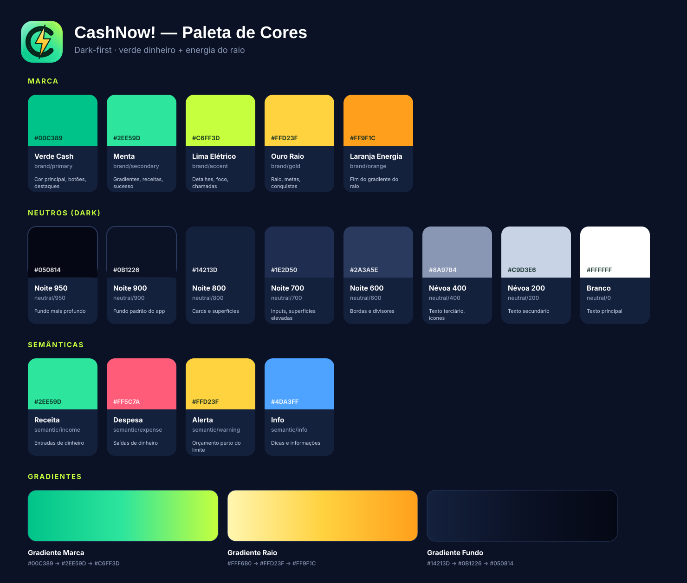

<p align="center">
  
</p>

<p align="center">
  
  
  
</p>

<p align="center">
  <a href="#-sobre">Sobre</a> •
  <a href="#-funcionalidades">Funcionalidades</a> •
  <a href="#-tecnologias">Tecnologias</a> •
  <a href="#-como-rodar">Como rodar</a> •
  <a href="#-estrutura">Estrutura</a> •
  <a href="#-identidade-visual">Identidade visual</a>
</p>

---

## ⚡ Sobre

Controlar o dinheiro costuma ser chato: planilha esquecida, gasto que some sem explicação e meta que nunca sai do papel.

O **CashNow!** é um app de controle financeiro pessoal que resolve isso de um jeito rápido e direto. Você registra suas entradas e saídas, acompanha seu saldo e define metas, tudo num lugar só.

## ✨ Funcionalidades

- [ ] 💚 **Receitas**: registrar entradas de dinheiro
- [ ] ❤️ **Despesas**: registrar saídas, com categorias
- [ ] ⭐ **Metas**: criar objetivos e acompanhar o progresso
- [ ] 📈 **Dashboard**: saldo atual e evolução mensal
- [ ] ⚠️ **Alertas**: aviso quando o orçamento chegar perto do limite

> Marque com `[x]` conforme for entregando cada uma.

## 🛠 Tecnologias

| Camada | Tecnologia |
|---|---|
| Linguagem | Java 21 |
| Framework | _ex.: Spring Boot_ |
| Banco de dados | _ex.: PostgreSQL / H2_ |
| Build | _ex.: Maven_ |
| Testes | _ex.: JUnit 5_ |

## 🚀 Como rodar

**Pré-requisitos:** Java 21+ e Git.

```bash
# 1. Clone o repositório
git clone https://github.com/SEU-USUARIO/cashnow.git
cd cashnow

# 2. Rode o projeto (ajuste conforme seu build)
./mvnw spring-boot:run
```

A aplicação sobe em `http://localhost:8080`.

## 📁 Estrutura

```
cashnow/
├── docs/
│   └── assets/
│       ├── cashnow-hero.svg              # banner animado deste README
│       ├── cashnow-icone.svg
│       ├── cashnow-logo-horizontal.svg
│       ├── cashnow-logo-horizontal-claro.svg
│       └── cashnow-paleta.svg
├── src/
│   ├── main/java/...                     # código-fonte
│   └── test/java/...                     # testes
└── README.md
```

## 🎨 Identidade visual

Dark-first: o verde do dinheiro com a energia do raio.

| Cor | Hex | Uso |
|---|---|---|
|  Verde Cash | `#00C389` | Cor principal, botões |
|  Menta | `#2EE59D` | Receitas, sucesso |
|  Lima Elétrico | `#C6FF3D` | Detalhes, foco |
|  Ouro Raio | `#FFD23F` | Metas, alertas |
|  Despesa | `#FF5C7A` | Saídas de dinheiro |
|  Noite 900 | `#0B1226` | Fundo do app |

<details>
<summary>Ver paleta completa</summary>
<br>

</details>

## 🤝 Contribuindo

1. Faça um fork do projeto
2. Crie sua branch: `git checkout -b feature/minha-feature`
3. Faça o commit: `git commit -m "feat: minha feature"`
4. Envie: `git push origin feature/minha-feature`
5. Abra um Pull Request

## 📄 Licença

Distribuído sob a licença MIT. Veja o arquivo `LICENSE` para mais detalhes.

---

<p align="center">
  Feito com ⚡ por <strong>Matheus</strong>
</p>